<div align="center">

# LTX Studio

**Turn a story into a consistent 3-minute film - locally, on one consumer GPU.**

A workflow and web app on top of [Lightricks LTX-2.5](https://github.com/Lightricks/LTX-2) (22B video + audio model).
You describe a story; LTX Studio writes the script, casts the characters, renders every shot with sound and dialogue,
checks the results and stitches the finished film - with the same faces, outfits and props from the first shot to the
last.

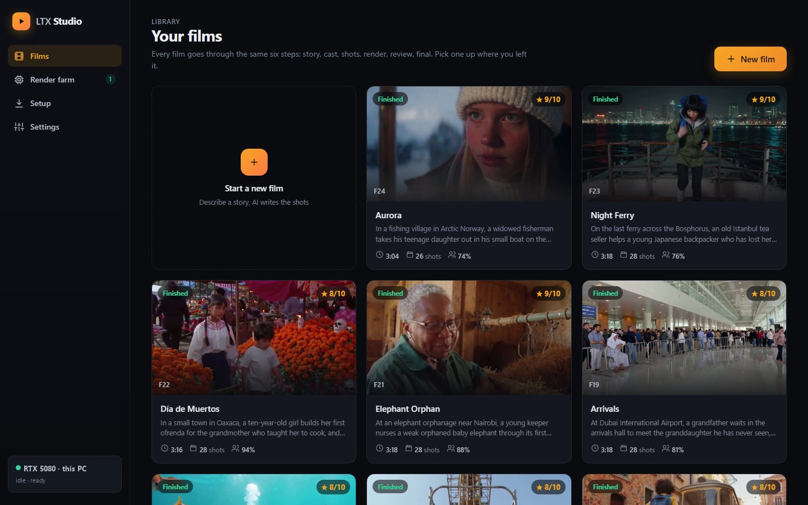

</div>

---

## Why

Text-to-video models make great 5-second clips. A *film* is harder: thirty shots in which the old fisherman is still
the same old fisherman, the toy is still the same toy, people speak their lines in the right language, and nothing odd
leaks into the frame. LTX Studio is the pipeline that handles that, wrapped in an app simple enough to use without
knowing how it works.

- **Runs on a 16 GB GPU.** The 22B model doesn't fit in VRAM; it is streamed block by block with a 4-bit NVFP4
  transformer (a runtime patch plus a Windows build of the NVFP4 kernel). Windows, Linux and Apple Silicon Macs.
- **Consistent characters.** Every character is cast once and appears from a reference sheet in every shot.
- **Video *and* audio.** Ambience, music and spoken dialogue in many languages.
- **Simple, not a node graph.** Six clear steps per film, one screen each - no wiring.
- **Self-checking.** Every shot is checked automatically; broken ones are redone without you asking.
- **Render farm.** Any PC with an NVIDIA GPU on your network can join with one file and render shots in parallel.
- **Installs from the browser.** One script opens the app; the Setup page installs everything else.

## How it works

Every film goes through the same six blocks:

| | Step | What happens |
|---|---|---|
| 1 | **Story** | Describe the idea in a few sentences; pick length, dialogue language and a look. The AI writer (Claude, or a local model through Ollama) writes the cast, places, props and every shot. |
| 2 | **Cast & places** | Each character gets a photoreal portrait and a 360° turnaround; each place and prop gets an image. Edit any description and recast in one click. |
| 3 | **Shot list** | One card per shot - action, camera, light, audio and dialogue. A script linter flags the mistakes that ruin shots *before* anything renders. |
| 4 | **Render** | Shots go into a queue and render on every available GPU. Live progress, time left, and quality checks as shots finish. |
| 5 | **Review** | Watch every shot. Approve it, take a new attempt, render without the reference sheet, edit the prompt and redo, trim a bad start, or go back to an earlier take. |
| 6 | **Final film** | The shots are stitched automatically. Player, contact sheet, quality numbers and your rating. |

<table>
<tr><td>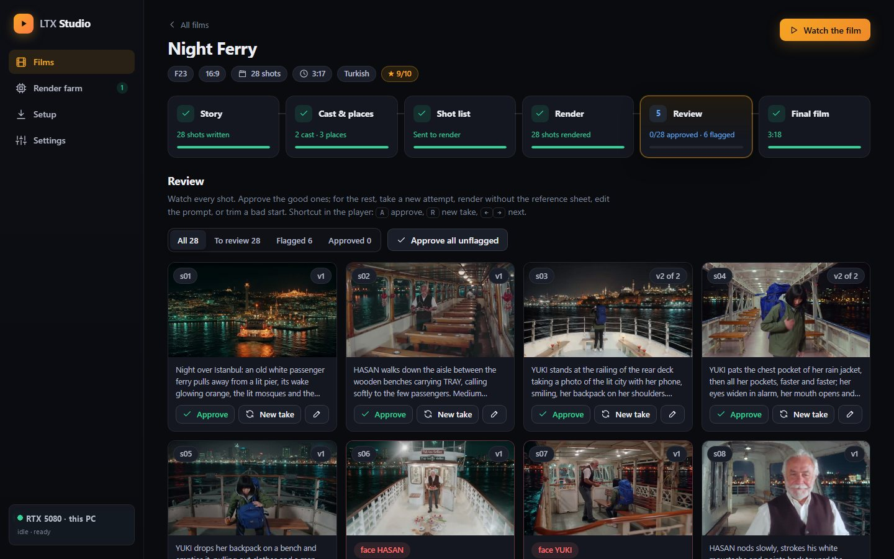</td><td>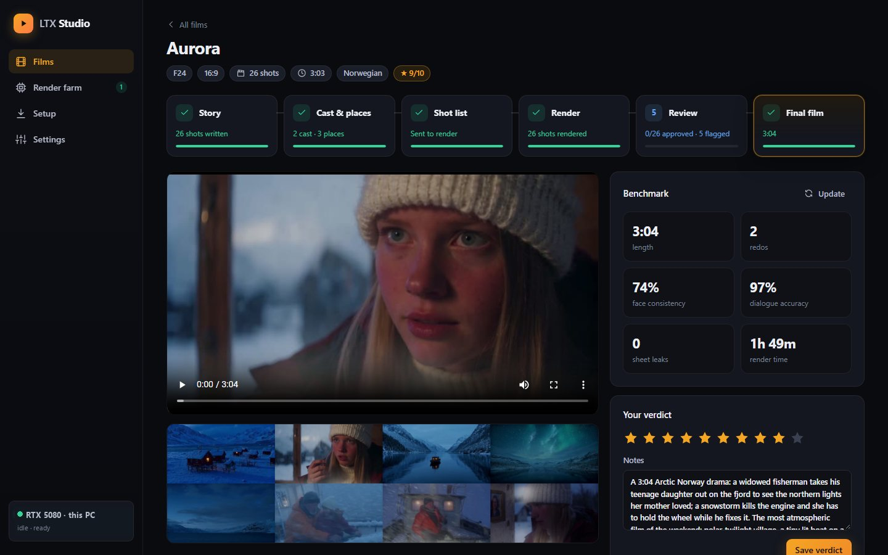</td></tr>
<tr><td align="center"><sub>Review: every shot, quality flags, one-click fixes</sub></td><td align="center"><sub>Final: the film, its quality numbers and your verdict</sub></td></tr>
<tr><td>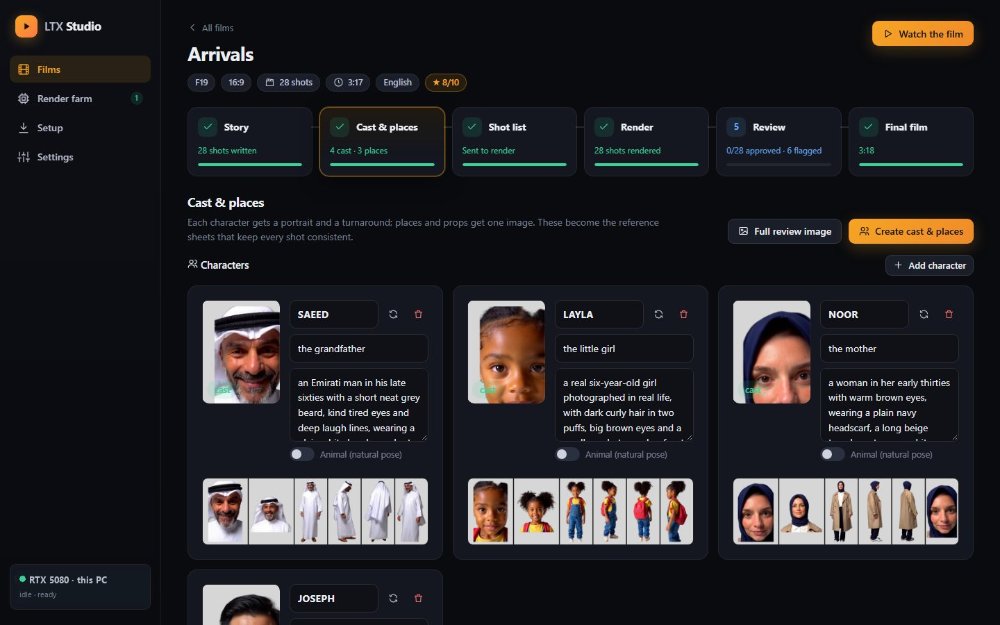</td><td>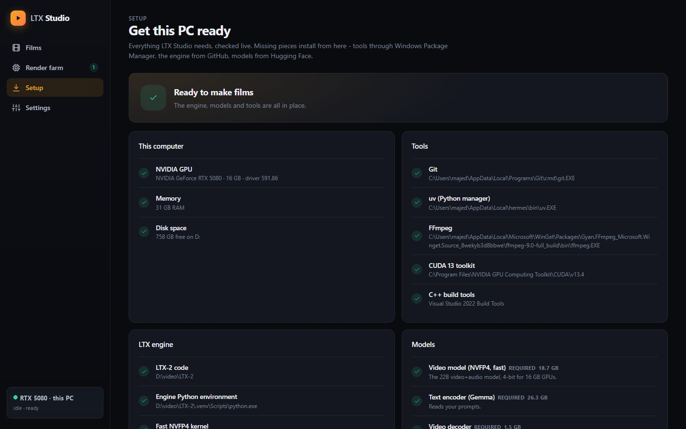</td></tr>
<tr><td align="center"><sub>Cast & places: portraits, turnarounds, locations</sub></td><td align="center"><sub>Setup: checks this PC and installs what's missing</sub></td></tr>
</table>

## Character design: how faces stay the same

**1. Cast once.** Each character is written as a fixed description - age, face, hair and the full outfit from head to
toe. LTX-2.5 renders a full-length portrait, then a short clip of the character turning around with a push-in to the
face. Two face crops and four body views are cut from that clip into a panel. Animals get a natural pose instead of
"standing upright".

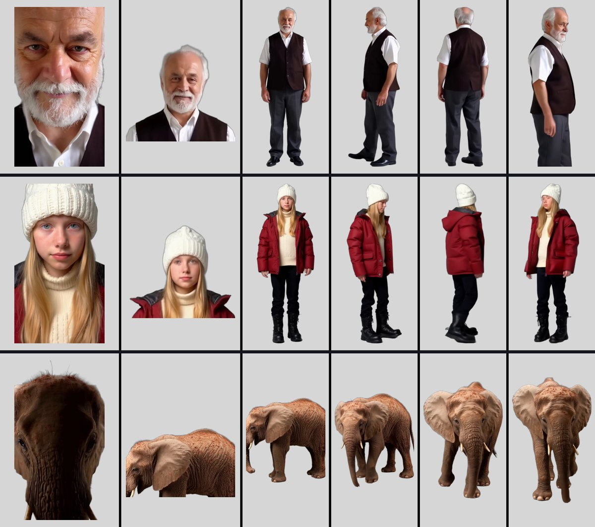

**2. One reference sheet per shot.** For every shot, the panels of exactly the characters (and props) in it are
combined into a sheet and passed to the model through the LTX Ingredients IC-LoRA, together with the shot prompt.

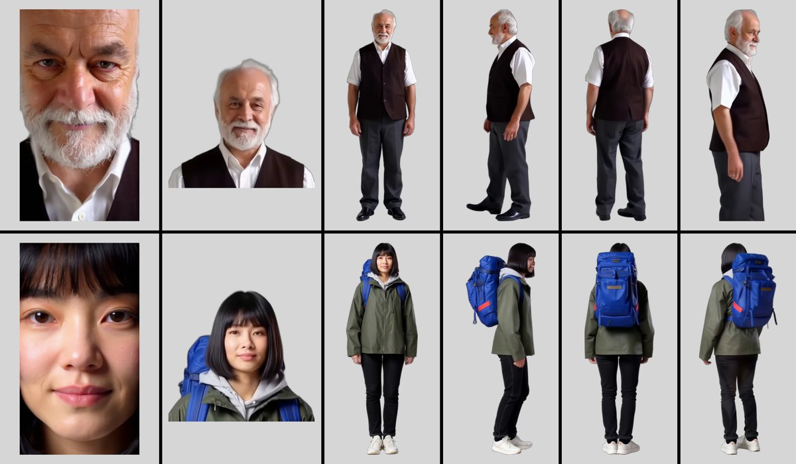

**3. The shot.** The model renders the scene - here, the tea seller crouching beside the backpacker - with the same
faces, waistcoat, jacket and backpack as the sheet:

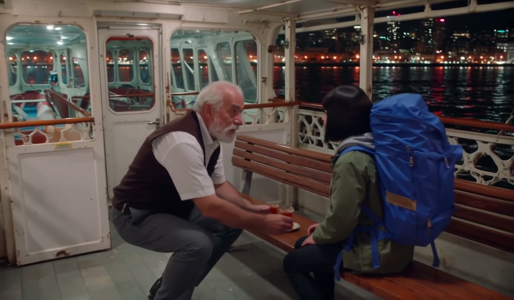

Behind the scenes the prompt is rewritten so it works: names become roles ("the tea seller", never "HASAN" - names get
painted into the picture as text), an opening sentence tells the model the first frame is the scene and not the sheet,
and shots with two people get a blocking line describing who stands where and what each looks like.

A complete small example - characters, place, props and four shots - is in
[`docs/examples/example_film.json`](docs/examples/example_film.json).

## How quality is measured

Every shot is checked automatically while the film renders (every four finished shots), and the whole film again when
it is done. The checks:

| Check | How | What happens |
|---|---|---|
| **Reference-sheet leak** | Detects the sheet's grey panel layout (flat grey cells + thin black gutters) frame by frame, and compares frames with the sheet itself. | A short flash at the start is trimmed off at stitch time; anything longer is re-rendered (new seed, then a simpler sheet). |
| **Face consistency** | Finds faces (YuNet) in sampled frames and compares them with the cast's face crops from several angles (SFace cosine similarity). Faces under 72 px are ignored. | Low matches are flagged for review. Per film: share of character appearances that match. |
| **Black bars / frozen / black** | Edge-band darkness, frame-to-frame motion, near-black frames (with an exception for intended night scenes). | Bars and frozen shots are re-rendered automatically. |
| **Dialogue accuracy** | Whisper transcribes each shot's speech in the line's own language and compares it with the script (character error rate; Japanese compared in kana, Chinese in simplified script, numbers spelled out). | Flagged if the speech doesn't match. |

Each film also gets a **benchmark row**: length, number of redos, render time, face consistency, dialogue accuracy,
leaks left in the final film, and your own 1-10 rating. You can see it on the Final step or run
`python ltxgen\factory.py bench films\<film>`.

**Typical results** on one RTX 5080 for a 3-minute, 28-shot film: about **2 hours** of rendering (~4.5 minutes per
7-second shot), face consistency **75-95%**, dialogue accuracy **92-100%** in English, Spanish, Italian, Portuguese,
Turkish, Norwegian, modern Japanese and Arabic, and **no** sheet leaks left in the final cut. Weaker: Cantonese and
archaic Japanese dialogue (these need a recorded voice track).

<table><tr>
<td align="center">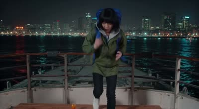</td>
<td align="center">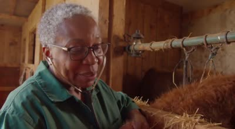</td>
<td align="center">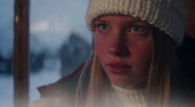</td>
<td align="center">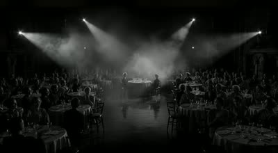</td>
</tr></table>

## Writing prompts that work

The AI writer and the script linter already follow these, but they help when you edit shots by hand:

- **One action per shot**, 5-8 seconds. Main action first, then camera, light, and `Audio:` with sounds, music and
  dialogue in quotes (`he says in Turkish "..."`).
- **Full outfits, empty hands, no fixed expressions** in character descriptions. Describe a smile or a mask *per shot* -
  the reference image wins over the prompt in close-ups.
- **Name the species** in shots without characters ("a herd of large wild African elephants", never "the herd").
- **Describe only the emotion you want.** "Her smile disappears" produces a big smile.
- **Write prop keys in capitals** (`PASSPORT`) so they join the shot's reference sheet - but only in shots where the
  person holding them is visible.
- **Close-ups of hands** render without a reference sheet (otherwise the whole sheet tends to leak in).
- **Some actions are beyond the model** (a scuba backward roll, complex sports plays); pick a simpler equivalent.

## Quick start

### Supported systems

| | Renders on | Model | Notes |
|---|---|---|---|
| **Windows 11** | NVIDIA RTX, 16 GB+ VRAM | 4-bit NVFP4 (fast) + fp8 for consistency | Developed and tested on an RTX 5080 |
| **Linux** (Ubuntu 22.04+ or similar) | NVIDIA RTX, 16 GB+ VRAM | 4-bit NVFP4 (fast) + fp8 for consistency | Studio, setup and worker tested; rendering uses the same engine as Windows |
| **macOS** | Apple Silicon (M1 or newer), 64 GB+ unified memory | full-precision bf16 (NVFP4/fp8 are NVIDIA-only) | Slower; 96 GB+ recommended |

All systems need 32 GB+ RAM and ~120 GB free disk. A computer without a supported GPU can still run the studio and
send shots to render workers on other PCs.

### Windows

```powershell
git clone https://github.com/UAEpro/ltx-studio D:\ltx-studio
cd D:\ltx-studio
powershell -ExecutionPolicy Bypass -File ltxgen\studio\install.ps1
```

### Linux / macOS

```bash
git clone https://github.com/UAEpro/ltx-studio ~/ltx-studio
cd ~/ltx-studio
bash ltxgen/studio/install.sh
```

Linux needs `git`, `ffmpeg` and a C++ compiler (`sudo apt install git ffmpeg build-essential`); macOS needs
[Homebrew](https://brew.sh) (`brew install git ffmpeg`). The Setup page shows the exact command for anything missing.

### Then, in the browser

The installer sets up the app's small Python environment and opens **http://localhost:7860/#/setup**. Press
**Install everything**: the LTX-2 engine and the models install with live progress (the right model for your GPU is
picked automatically). The character-consistency model is gated on Hugging Face - accept its licence there and paste a
token in **Settings** first. Optionally add a Claude API key (or install [Ollama](https://ollama.com)) for the AI
script writer.

To start the studio again later: `ltxgen/studio/start_studio.ps1` (Windows) or `ltxgen/studio/start_studio.sh`.

### More computers

**Render farm → Add a computer.** Windows PCs download a join file that copies the engine and models from the PCs
already in the farm. Linux and macOS computers run one command that the page shows for you:

```bash
curl -fsSL http://YOUR-STUDIO-PC:7860/join.sh | HF_TOKEN=hf_xxx bash
```

Then: **Films → New film**, describe a story, and follow the six blocks.

### Command line

Everything the app does is also available from the command line:

```powershell
python ltxgen\ltxgen.py generate --prompt "..." --preset draft --seconds 5   # one clip
python ltxgen\factory.py prepare films\my_film --assets-only               # cast + places
python ltxgen\factory.py prepare films\my_film                             # build and submit the film
python ltxgen\factory.py qa films\my_film                                  # quality checks
python ltxgen\factory.py reshot films\my_film s07 --seed 1234              # redo one shot
python ltxgen\factory.py bench films\my_film                               # benchmark row
```

An MCP server (`ltxgen/mcp_server.py`) exposes generation to AI agents.

## Architecture

```
ltxgen/
  ltxgen.py            CLI: generate / frame / sheet / stitch / doctor (wraps the LTX-2 pipelines)
  run_pipeline.py      runtime patches: NVFP4 block streaming on 16 GB, large-checkpoint streaming on Windows
  factory.py           the film pipeline: lint, casting, reference sheets, prompts, QA, autofix, benchmark
  cast.py              casting: portrait -> turnaround -> face/body panel; reference-sheet composer
  qa.py                QA: sheet-leak detector, face match, bars/frozen/black, multilingual dialogue scoring
  studio/
    server.py          FastAPI app + distributed shot queue (workers claim shots, leases, auto-stitch)
    films.py           film API, background jobs, monitor (QA + autofix as shots finish, then finish the film)
    setup_page.py      system checks + installers (winget, LTX-2, Hugging Face models)
    worker.py          render worker (one per GPU PC)
    film_prompt.md     rules for the AI script writer
    ui/                the web app - plain ES modules + CSS, no build step
docs/examples/         example film file and character-design images
```

A film is a folder `films/<id>/` with a `film.json` (story, cast, places, props, shots); renders, casts and models
stay local and are not part of the repository.

## Credits and licences

- **Model:** [LTX-2.5](https://github.com/Lightricks/LTX-2) by Lightricks, under the LTX-2.x Community License
  (free for commercial use under $10M annual revenue - read the licence before using generated films commercially).
  The model and the LTX-2 code are downloaded separately and are not part of this repository.
- **Face models for QA:** [OpenCV Zoo](https://github.com/opencv/opencv_zoo) YuNet + SFace.
- **Speech scoring:** [faster-whisper](https://github.com/SYSTRAN/faster-whisper).
- **This project's code:** MIT - see [LICENSE](LICENSE).
